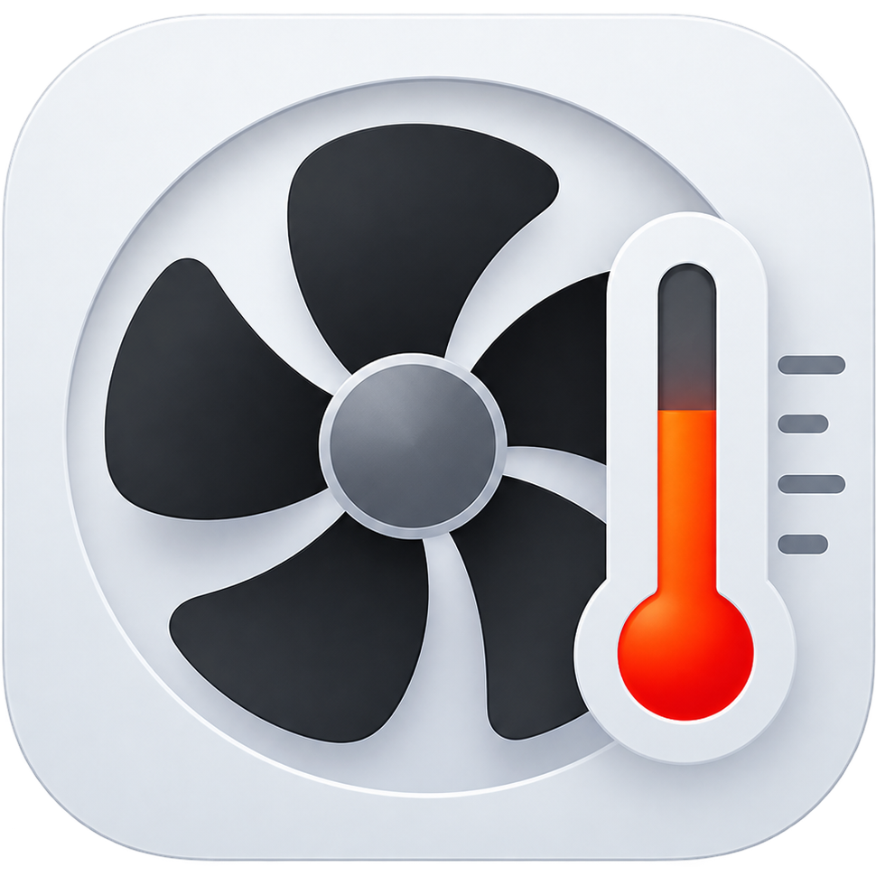

# &nbsp;&nbsp;Minilet <br/>

Your Mac's temperature, fans, memory, CPU and GPU. One small menu-bar app.


## What you can do

- Monitor live temperature, fan speeds, RAM, CPU and GPU activity.
- Choose fixed fan speeds or temperature-based cooling, with four cooling curves.
- Spot recent spikes with five-minute CPU, GPU and memory-pressure histories.
- Check RAM usage, compressed memory, swap and memory pressure.
- Find the ten apps using the most memory and quit them normally from the menu.
- Keep everything in one compact menu-bar item, with distinct memory, CPU and GPU meters.

## Install

Requires an Apple Silicon Mac with fans and macOS 13 or newer.

1. Download `Minilet-<version>-arm64.zip` from [GitHub Releases](https://github.com/brunnolou/minilet/releases). Choose the app ZIP, not the source archive.
2. Quit any older Minilet, unzip the download and move `Minilet.app` to `/Applications`, replacing the old copy.
3. Open Minilet and click the fan icon near the clock.

Keep only one installed copy so macOS doesn't open an older version. No developer tools or extra software are needed.

<details>
<summary>If macOS blocks the app</summary>

Minilet isn't verified by Apple. After trying to open it, go to **System Settings → Privacy & Security → Open Anyway** and confirm. Only approve a download you trust.


</details>

## Cooling controls

- **Speed** selects a fixed fan speed. **Automatic** returns control to macOS.
- **Cool to** sets a temperature goal. While it's on, **Max speed** limits normal fan speed.
- **Curve** changes how gently or quickly the fans respond.

Hover over the memory section to see the biggest app memory users and their Quit buttons.

## Permissions and safety

Monitoring needs no administrator permission. Fan control asks for approval each session.

Launch and wake start in monitoring-only mode. Select fan control again when you want it. Normal quit restores automatic control; forced termination may not.

Don't run another fan controller alongside Minilet. Low temperature goals may be unreachable under load, and emergency cooling can override the speed limit while Cool to is on. This is an experimental app, intended for your own Mac, and comes without warranty.

<details>
<summary>Build from source</summary>

Building requires macOS, Apple's command-line tools, Swift 6 and Python 3.

```sh
git clone https://github.com/brunnolou/minilet.git
cd minilet
./build.sh
```

The app is created at `.build/Minilet.app`. Run tests with `./build.sh --test`.

</details>

## License and support

Free and open source under [GPL-3.0-only](LICENSE.md). See [NOTICE](NOTICE) for project notices.

[Buy me a coffee](https://buymeacoffee.com/brunnolou) if you'd like to support Minilet. Donations are optional.
